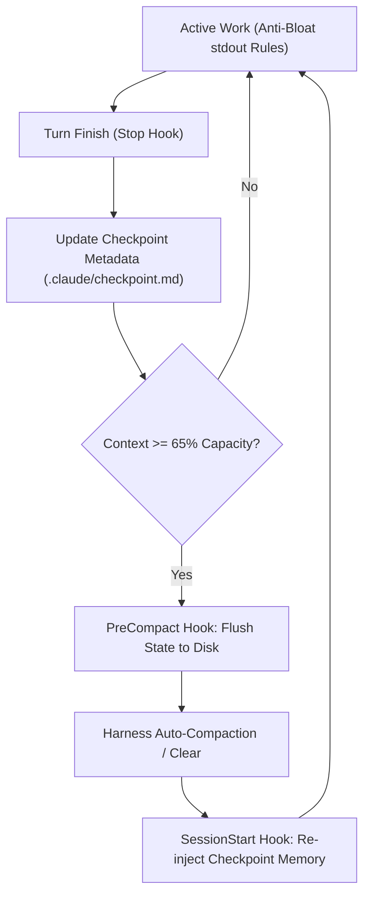

# auto-compact-dustpan · Automated Context Cleaner & Memory Restoration

> **Purpose:** Automate context housekeeping. While manual checkpointing requires developer vigilance, **auto-compact-dustpan** binds system hooks (`Stop`, `PreCompact`, and `SessionStart:compact`) to sweep token waste, safeguard task state to disk before compaction, and automatically re-inject memory post-compaction.

---

## 1. The Automated Lifecycle Loop

1. **During Execution (Anti-Bloat Guardrails):**
   - Noisy tests run in subagents or redirect to temporary logs.
   - At the completion of each subtask or batch, update **1. Completed Items** and **4. Exact Next Step** in `.claude/checkpoint.md`.
2. **On Turn End (`Stop` Hook):**
   - Automatically synchronizes current timestamp, Git branch, and short commit hash in `.claude/checkpoint.md`.
3. **At 65% Context Capacity (`PreCompact` Hook):**
   - Before the window fills or degrades, triggers `garry-dustpan` in `PreCompact` mode to flush state to disk.
4. **Post-Compaction (`SessionStart:compact` Hook):**
   - As soon as compaction finishes, the hook reads `.claude/checkpoint.md` and injects the active memory directly into the fresh turn. The agent resumes work immediately without rescanning the repository.

---

## 2. Shell & PowerShell Hook Integrations

The hook scripts live in `hooks/`:
- **Windows:** `hooks/garry-dustpan.ps1 -Mode [Stop|PreCompact|PostCompact]`
- **Unix / macOS:** `hooks/garry-dustpan.sh [Stop|PreCompact|PostCompact]`

Ensure your harness configuration points to these hooks or invokes them during task lifecycle transitions.
