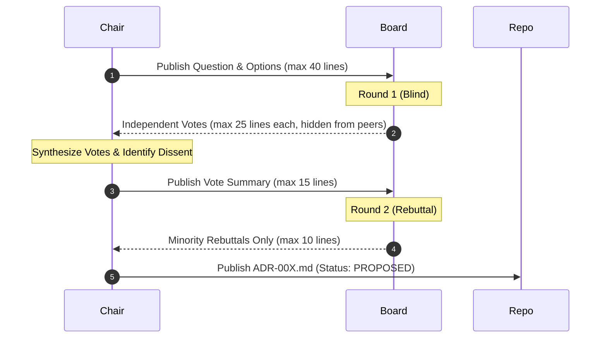

# blind-voting-board · Multi-Agent Architectural Governance

> **Purpose:** Resolve high-stakes, irreversible architectural choices (e.g., framework migrations, authorization models, cloud hosting, payment providers) using a formal multi-agent blind-voting protocol. Prevents single-model cognitive bias and groupthink.

---

## 1. When to Convene the Board

Convene the Blind Voting Board **ONLY** for decisions that are expensive or painful to reverse:
- Language, runtime, or core framework migrations.
- Data schema models for roles, permissions (RBAC), and immutable audit logs.
- Third-party SaaS integrations handling customer PII or financial transactions.
- Re-architecting project phases or deployment topology.

*Reversible tactical decisions are handled directly by the lead engineer without convening the board.*

---

## 2. Specialized Board Seats

Each seat operates as an independent subagent with a distinct perspective:

| Seat | Mandate | Primary Focus |
|:-----|:--------|:--------------|
| **President (Chair)** | Process facilitation & synthesis | Chairs debate, aggregates votes, drafts final ADR. Does not vote unless tied. |
| **Architecture** | Long-term maintainability | System coupling, schema elegance, tech debt, extensibility. |
| **Security & Compliance** | Data integrity & attack surface | OWASP, encryption, tenant isolation, privacy compliance (GDPR/CCPA). |
| **Product & Operations** | Usability & time-to-market | Non-technical stakeholder experience, velocity, operational simplicity. |
| **Costs & Infrastructure** | Financial sustainability | Monthly hosting spend, infrastructure overhead, maintenance cost in 2–5 years. |
| **Marketing & Growth** | Conversion & discoverability | Analytics, SEO, user onboarding friction, consent models. |
| **External Voice** | Cross-family model validation | Independent review (e.g., Gemini or Claude) checking for blind spots. |

---

## 3. The 2-Round Blind-Voting Protocol

1. **The Question:** The Chair writes `docs/adr/proposals/QUESTION.md` (max 40 lines): context, options, hard constraints.
2. **Round 1 (Blind):** Each seat submits `vote-<seat>.md` (max 25 lines) without seeing other votes. Format: Option · 3 Reasons · 2 Risks · Condition to change vote · Confidence (1–5).
3. **Round 2 (Rebuttal):** The Chair shares a concise 15-line summary of all votes. Only minority seats may submit a brief rebuttal (max 10 lines).
4. **Formal ADR Generation:** The Chair compiles `docs/adr/ADR-00X-<topic>.md` documenting the decision, consensus, dissenting rationales, reversibility plan, and owner sign-off requirement.

