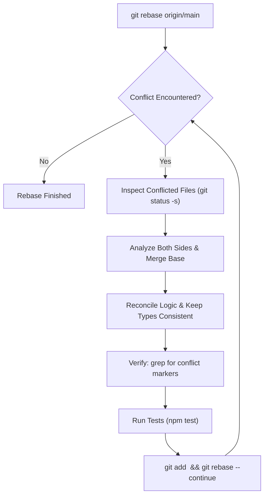

# git-rebase-conflict-resolver · Surgical Conflict Resolution

> **Purpose:** Resolve git merge and rebase conflicts methodically by analyzing intent from both branches, avoiding blind overwrites, and validating compile-time types and test suites before completing the rebase.

---

## 1. Golden Rules of Conflict Resolution

1. **Never Blindly Choose `ours` or `theirs`:** Both branches contain valid engineering intent. Understand why each change was made before merging.
2. **Inspect the Merge Base:** Determine the original common ancestor to understand what each side changed:
   ```bash
   git merge-base HEAD <target-branch>
   ```
3. **Verify Zero Leftover Markers:** Never commit code with remaining `<<<<<<<`, `=======`, or `>>>>>>>` markers.
4. **Mandatory Test Verification:** Before running `git rebase --continue`, compile the code and execute the test suite.

---

## 2. Step-by-Step Resolution Workflow



---

## 3. Conflict Marker Detection Check

Before staging resolved files, run a fail-fast regex check:

```bash
# Verify no lingering markers exist in tracked files
git diff --check
git grep -n -E "^<{7}|^={7}|^>{7}" || echo "Clean: No conflict markers found."
```
