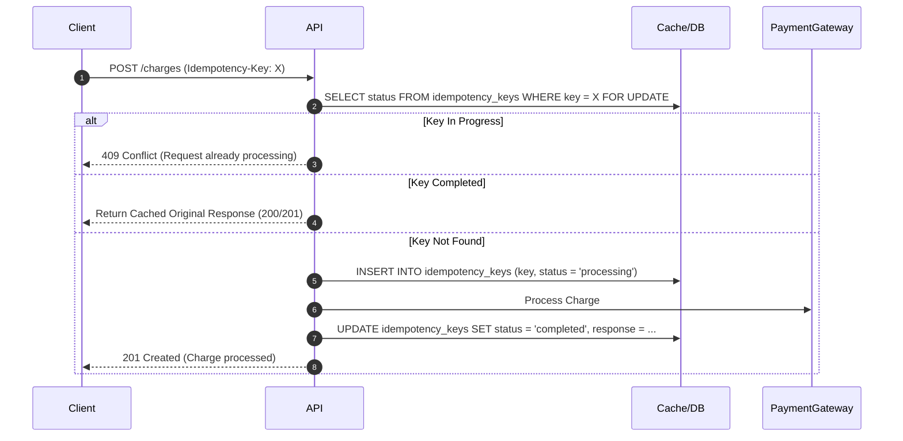

# idempotent-transactions · Idempotency & Webhook Resilience

> **Purpose:** Ensure that critical financial, payment, and state-changing mutations can be safely retried over unreliable networks without causing double-charges, duplicate records, or inconsistent balances.

---

## 1. Idempotency Key Architecture

Every modifying request (POST/PATCH/PUT) touching balances or external APIs must accept an `Idempotency-Key` header (e.g., UUIDv7):



---

## 2. Webhook Signature Verification (HMAC)

- Never trust incoming webhooks by URL presence alone.
- Validate payload signatures using HMAC-SHA256 with constant-time equality comparisons (`crypto.timingSafeEqual`) to prevent timing attacks:

```typescript
export function verifyWebhookSignature(
  rawBody: string | Buffer,
  signatureHeader: string,
  secret: string
): boolean {
  const hmac = crypto.createHmac('sha256', secret);
  const digest = Buffer.from(hmac.update(rawBody).digest('hex'), 'utf8');
  const expected = Buffer.from(signatureHeader, 'utf8');
  if (digest.length !== expected.length) return false;
  return crypto.timingSafeEqual(digest, expected);
}
```

---

## 3. Concurrency Stress Testing Rule

Every payment, webhook, or balance-altering handler **MUST** include an automated integration test verifying concurrent execution:
- Dispatch two identical requests in parallel with the same idempotency key using `Promise.all([charge(key), charge(key)])`.
- **Assertion:** Exactly **one** ledger entry is created, and both requests resolve cleanly with identical output.
