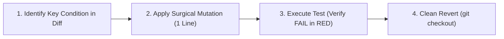

# mutation-testing · Surgical Mutation Verification Protocol

> **Purpose:** Irrefutably prove that automated tests in a pull request or code change are not false positives or trivial checks that "always pass green". Enforces introducing a real fault into business logic and verifying that the relevant test catches it.

---

## 1. When to Invoke This Skill

- Mandatory requirement before any code review approval or PR merge.
- Required on any diff modifying financial logic, security checks, rate limits, identity validation, authentication, or calculations.
- Whenever a test passes immediately on the first run to confirm it is actually exercising the intended code path.

---

## 2. The 4-Step Surgical Mutation Protocol



### Step 1: Identify Key Condition in Diff
Inspect the diff against the target branch:
```bash
git diff origin/main...HEAD -U2
```
Locate the single line containing the newly implemented critical rule. Examples:
- Checksum / validation logic: `remainder === 0 ? 0 : 11 - remainder`
- Boundary comparison: `daysElapsed <= 7`
- State guard: `payment.status === 'completed' && !payment.refunded`
- Banker's half-even rounding threshold.

### Step 2: Apply Surgical Mutation
Modify **only that single line** to deliberately violate the business rule:
- Invert boolean operators: change `<=` to `>`.
- Corrupt formula: change `+ 1` to `+ 2` or hardcode `return true;`.
- Remove state filters: eliminate `WHERE refunded = false`.

> **CRITICAL WARNING:** Never commit a mutation. It is an ephemeral modification in the working directory.

### Step 3: Run the Specific Test Suite
Execute only the test file responsible for catching the rule:
```bash
npm test -- path/to/feature.spec.ts
```
**Success Criterion for Mutation:**
The test **MUST FAIL** with red output (`FAIL`, `AssertionError`, or non-zero exit code). If the test still passes green with broken code, the test is defective and the PR must be **REJECTED / FLAGGED**.

### Step 4: Clean Revert and Verification
Immediately restore the modified file:
```bash
git checkout -- <mutated_file>
git status -s
```
Confirm the working tree is completely clean and all tests return to green.

---

## 3. Formatted Mutation Evidence Report

Document the verification in PR notes or commit descriptions using this 4-line block:

```markdown
### Mutation Verification Evidence (mutation-testing)
- **Mutated Line:** `src/lib/validation.ts:42` (changed `11 - remainder` to `10 - remainder`)
- **Triggered Test:** `tests/validation.spec.ts` -> "validates checksum modulus 11"
- **Failure Output:** `AssertionError: expected false to be true (Exit code 1)`
- **Post-Revert State:** Cleanly reverted (`git checkout -- .`), 100% of tests passing green.
```
