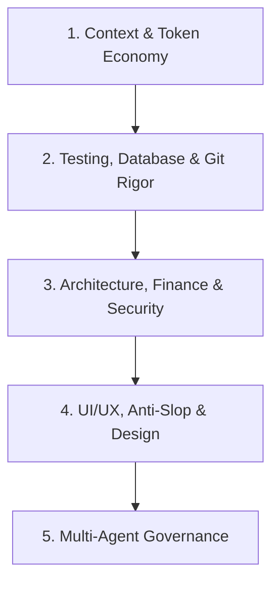

# using-izzi-to-work · Master Agentic Engineering Protocol

> **Purpose:** Izzi to Work establishes uncompromising software engineering discipline for autonomous coding agents across platforms (Google Antigravity, Claude Code, Cursor, Codex, Gemini CLI, OpenCode, Pi, Kimi, Devin, Hermes, and Muse).

---

## 1. Prime Directive: Check and Invoke Skills Before Acting

Whenever you receive a task or prompt:
1. **Analyze Requirements Against the Catalog:** Match user needs against the 25 engineering skills in the Izzi to Work catalog.
2. **Invoke Relevant Skills First:** Load the applicable `SKILL.md` before taking implementation steps.
3. **Never Rationalize Bypassing Engineering Discipline:** Follow the Red Flags Table below.

---

## 2. Red Flags Rationalization Table

| Rationalization Excuse | Hard Reality & Required Action |
|:-----------------------|:-------------------------------|
| *"This is just a quick one-line fix, no need to mutate or verify."* | **Surgical Mutation is mandatory:** 1-line changes are the most common source of regressions. Introduce a 1-character bug, verify the test suite turns red, and clean revert. |
| *"The test suite passed in green, so the code is solid."* | **Green tests can be false positives:** Without mutation testing (`mutation-testing`), an empty or tautological assertion also passes green. |
| *"I'll dump the full test log into context so the user sees everything."* | **Context Bloat Trap:** Dumping 500 lines of stdout rapidly fills the token window. Redirect to `%TEMP%` or a file, grep for `FAIL|ERR`, and report concise summaries (`token-budget-guard`). |
| *"I'll use JavaScript `number` for this total since it's just currency display."* | **Strict Financial Ban:** IEEE 754 floats cause silent rounding drift. Always use `Decimal` with banker's half-even rounding (`financial-integrity`). |
| *"We can mock PostgreSQL with an in-memory database to test faster."* | **Mocks hide race conditions:** In-memory mocks miss `SELECT ... FOR UPDATE SKIP LOCKED`, RLS policies, and `EXCLUDE` constraints. Use real PostgreSQL (`postgres-live-testing`). |
| *"We'll clean up the git commit history and resolve conflicts at the end."* | **Merge base inspection first:** Resolve conflicts surgically at each step, ensuring types and tests pass cleanly (`git-rebase-conflict-resolver`). |

---

## 3. The 5 Pillars of Izzi to Work

1. **Context & Token Economy:** Checkpoint state to `.claude/checkpoint.md`, autocompact at 65% capacity, protect tokens.
2. **Testing, Database & Git Rigor:** 4-step mutation testing, silent Playwright dual-viewports (360px/1280px), real PostgreSQL concurrency, zero-downtime SQL migrations.
3. **Architecture, Finance & Security:** Decimal arithmetic, 404 anti-enumeration for foreign resources, mandatory RLS, 11-section specs, OWASP audits, pre-commit secret leak scanners.
4. **UI/UX, Anti-Slop & Design:** Clean code without decorative AI comments, editorial luxury design systems, Nielsen heuristic reviews, responsive layout audits at 360px.
5. **Multi-Agent Governance:** Blind-voting board for irreversible decisions (`ADR-00X.md`), and zero-trust verification squads.

---

## 4. Platform Tool Adaptation

Tools and capabilities adapt seamlessly to your active host environment:

- **Google Antigravity CLI/IDE (`agy`):** Read [antigravity-tools.md](file:///d:/xampp/htdocs/izzi-to-work/skills/using-izzi-to-work/references/antigravity-tools.md). Uses `invoke_subagent` (`self` or `research`), `write_to_file`, `replace_file_content`, and task tracking via task artifact.
- **Claude Code:** Read [claude-code-tools.md](file:///d:/xampp/htdocs/izzi-to-work/skills/using-izzi-to-work/references/claude-code-tools.md). Uses `Agent`, `TodoWrite`, `Read`, `Write`, `Edit`, and `Bash`.
- **Codex:** Read [codex-tools.md](file:///d:/xampp/htdocs/izzi-to-work/skills/using-izzi-to-work/references/codex-tools.md).
- **Gemini CLI:** Read [gemini-tools.md](file:///d:/xampp/htdocs/izzi-to-work/skills/using-izzi-to-work/references/gemini-tools.md).
- **Hermes Agent:** Read [hermes-tools.md](file:///d:/xampp/htdocs/izzi-to-work/skills/using-izzi-to-work/references/hermes-tools.md).
- **Muse:** Read [muse-tools.md](file:///d:/xampp/htdocs/izzi-to-work/skills/using-izzi-to-work/references/muse-tools.md).
- **Pi:** Read [pi-tools.md](file:///d:/xampp/htdocs/izzi-to-work/skills/using-izzi-to-work/references/pi-tools.md).

