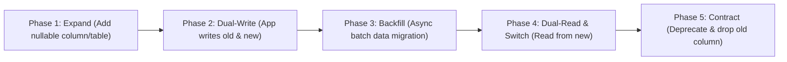

# zero-downtime-migrations · Non-Blocking Database Evolution

> **Purpose:** Execute schema migrations safely in high-traffic production environments without locking tables, dropping active connections, or causing downtime.

---

## 1. The Expand-Contract (Parallel Run) Pattern

Never execute destructive or breaking schema modifications in a single deployment:



---

## 2. Safe vs. Dangerous Migration Operations

| Operation | Dangerous Pattern | Safe Zero-Downtime Alternative |
|:----------|:------------------|:-------------------------------|
| Adding an Index | `CREATE INDEX idx_user ON users(email);` *(Locks writes on table)* | `CREATE INDEX CONCURRENTLY idx_user ON users(email);` |
| Adding a NOT NULL Column | `ALTER TABLE orders ADD COLUMN total NUMERIC NOT NULL;` *(Fails or rewrites table)* | 1. Add column as nullable.<br>2. Add NOT VALID check constraint.<br>3. Backfill values.<br>4. Validate constraint. |
| Dropping a Column | `ALTER TABLE users DROP COLUMN phone;` *(Breaks old running pods)* | Deploy code that stops referencing `phone`, verify across all pods, then drop column in a later release. |
| Changing Column Type | `ALTER TABLE logs ALTER COLUMN id TYPE BIGINT;` *(Full table rewrite lock)* | Create new column `id_v2`, dual-write, backfill, swap. |

---

## 3. Mandatory Migration Settings

Always enforce lock timeouts and statement timeouts in migration scripts to prevent long-running table lock queues:

```sql
-- Abort quickly if an exclusive lock cannot be acquired within 3 seconds
SET lock_timeout = '3s';
SET statement_timeout = '30s';
```

---

## 4. Branch Versioning & Conflict Prevention

- Use timestamped migration prefixes (`YYYYMMDDHHMMSS_name.sql`) or monotonic integer numbering coordinated with `main`.
- Verify no migrations have been committed to `main` with higher or conflicting timestamps before merging.

