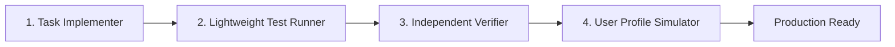

# zero-trust-squad · Zero-Trust Multi-Agent Architecture

> **Purpose:** Eliminate single-agent blind spots by decoupling software engineering tasks into specialized, isolated roles with strict boundary handoffs. The verifier never trusts the implementer's self-reported success.

---

## 1. The 4 Specialized Squad Roles

1. **Task Implementer (`implementer`):**
   - Focus: Writing functional code and unit tests according to the architectural specification.
   - Constraint: Does not verify or approve its own pull requests.
2. **Lightweight Test Runner (`test-runner`):**
   - Focus: Running isolated test suites using lightweight models (e.g., Haiku or Flash) to keep heavy test logs out of the main orchestrator's context window.
   - Output: Pass/Fail status and succinct error snippets.
3. **Independent Verifier (`verifier`):**
   - Focus: Auditing diffs without having written them. Assumes zero trust in the implementer's report.
   - Duties: Verifies acceptance criteria, performs surgical mutation testing (`mutation-testing`), and categorizes feedback into **Blocking Defects** vs. **Non-Blocking Improvements**.
4. **User Profile Simulator (`persona-simulator`):**
   - Focus: Exercising the newly implemented UI or API from the viewpoint of real user personas (e.g., non-technical admin, customer on slow mobile connection, unauthorized third-party attacker).

---

## 2. The Verification Rules of Engagement

The `verifier` role must execute in this exact sequence:
1. **Scope Inspection:** Check that `git diff --stat` touches **only** files relevant to the specific task.
2. **Rule Enforcement:** Ensure no floating-point arithmetic for money, proper RLS enforcement, semantic HTTP status codes (404 instead of 403), and no empty catch blocks.
3. **Mutation Proof:** Introduce a surgical mutation to confirm the test suite fails red.
4. **Clean Handoff:** Issue either **APPROVED** or **CHANGES_REQUESTED** with actionable remediation code snippets.

